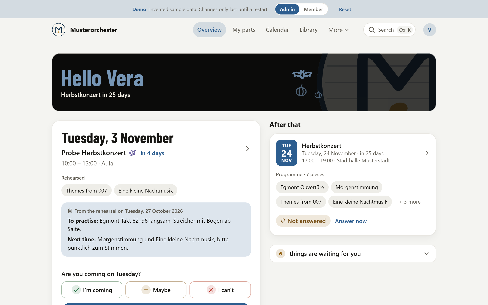
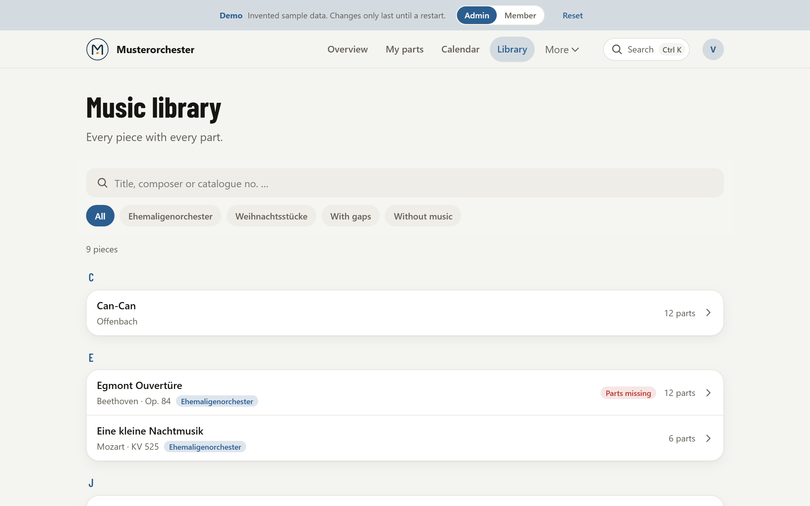
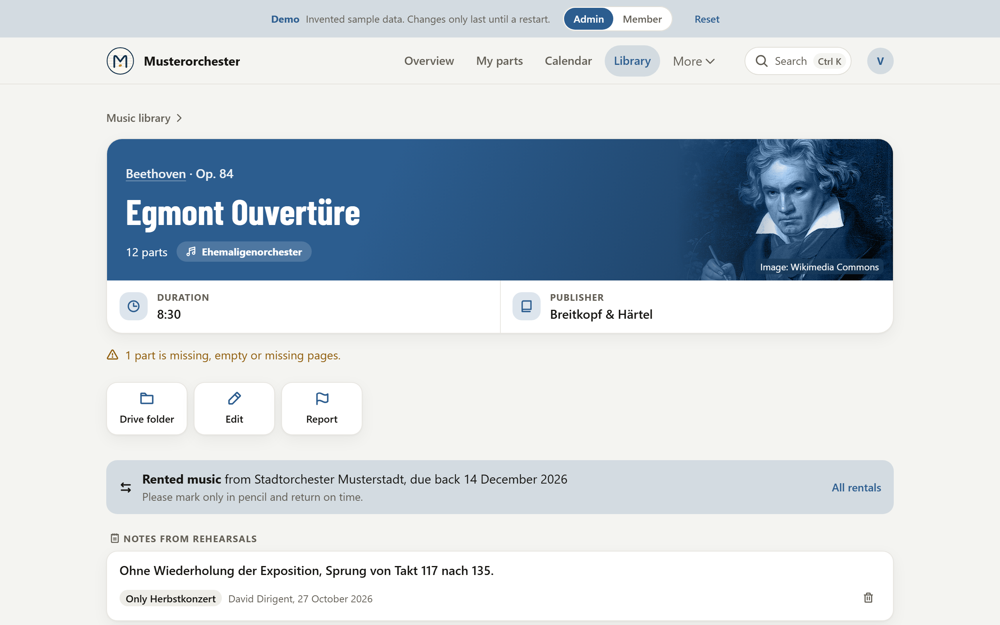
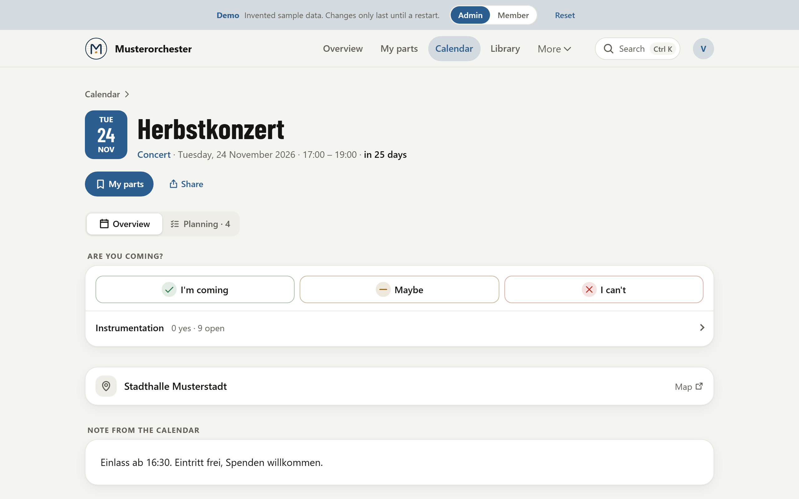
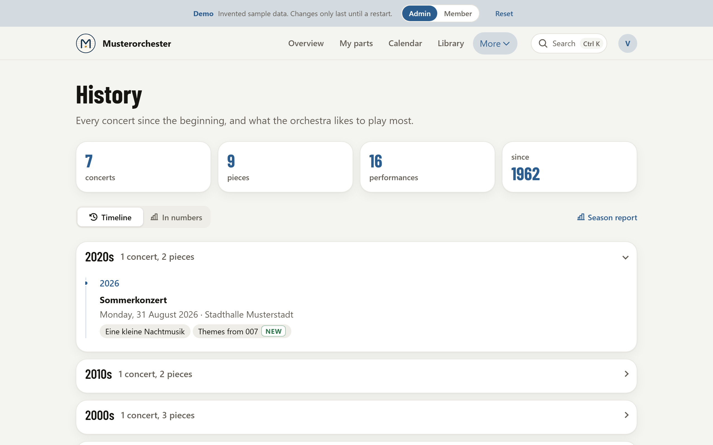
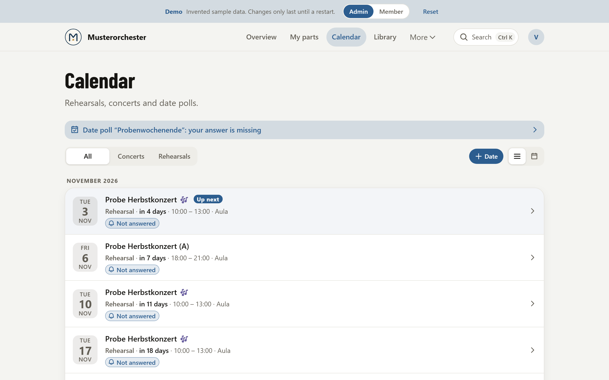
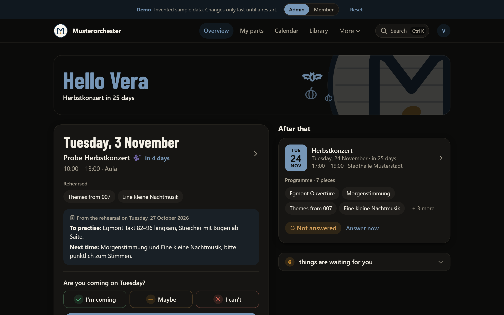
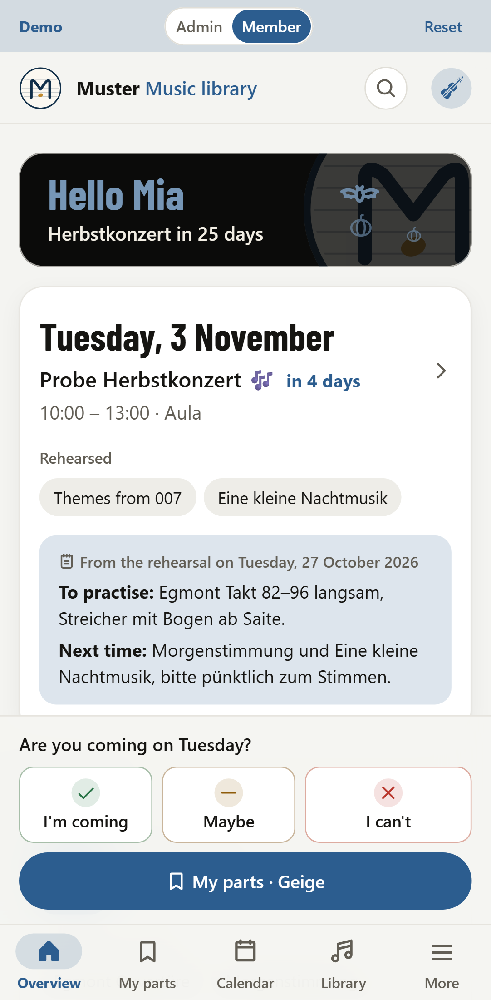
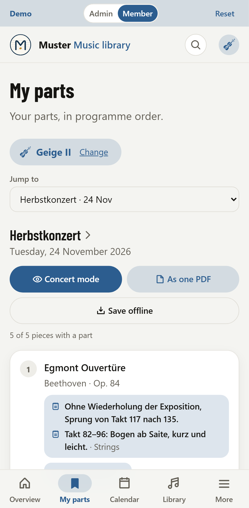
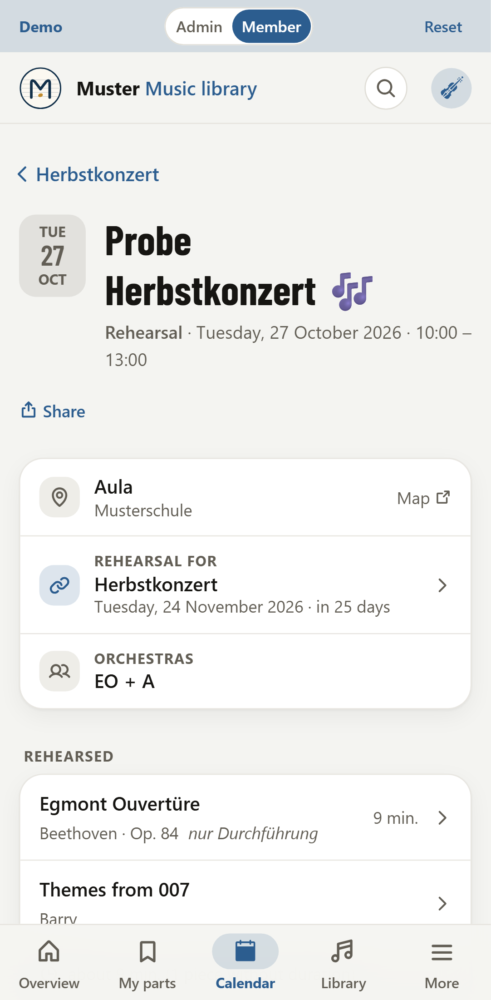

<div align="center">


# Sheetmanagement

**The sheet music library, rehearsals and concerts of an orchestra in one place, on top of the Google Drive, Calendar and Sheets you already use.**

[](https://github.com/lgreil/sheetmanagement/actions/workflows/ci.yml)
[](https://github.com/lgreil/sheetmanagement/actions/workflows/deploy.yml)
[](LICENSE)


[**Try the live demo**](https://noten-demo.bachkreis.workers.dev) · [Wiki](https://github.com/lgreil/sheetmanagement/wiki) · [Roadmap](https://github.com/lgreil/sheetmanagement/issues/73) · [Report a bug](https://github.com/lgreil/sheetmanagement/issues/new/choose)



</div>

## Why

Most amateur orchestras already keep their sheet music in Google Drive (one folder per piece, one PDF per part), their dates in Google Calendar and their concert history in a spreadsheet. Sheetmanagement reads all three and turns them into one app that members open on their phone: *when is the next rehearsal, am I coming, where's my part?* answered in seconds, even in a hall without reception.

Drive, Calendar and Sheets stay fully usable on their own. Nothing is locked in.

- **Free to run:** Cloudflare's free plan and Google's free APIs. No paid services, no domain needed.
- **For members on the phone:** installable, works offline, big touch targets, light and dark mode.
- **For organisers on a laptop:** programmes, sign-ups, rehearsal plans, attendance, rented music, the GEMA list.
- **Lightweight:** SvelteKit on Cloudflare Workers, no runtime dependencies besides SvelteKit, Google APIs called with plain `fetch`.
- **English or German**, one language per deployment.

## Screenshots

| | |
|---|---|
|  <br> **Library**: every piece in the Drive archive, searchable, with what's missing |  <br> **Piece**: parts, duration, rented music, notes agreed in rehearsal |
|  <br> **Concert**: programme, sign-ups per section, the rehearsal plan |  <br> **History**: every past concert, most played pieces and composers |
|  <br> **Calendar**: rehearsals and concerts from Google Calendar |  <br> **Dark mode**, with the orchestra's own accent colour |

<p align="center">



</p>

## Features

- **Library:** the Drive archive as a searchable list, one page per piece with all parts; missing or suspiciously short parts are flagged.
- **My parts:** each member's own parts in programme order, a concert mode, everything as one PDF, saved offline.
- **Calendar and sign-ups:** rehearsals and concerts from Google Calendar, "I'm coming / maybe / I can't" in one tap, reminders by push or email.
- **Programmes and rehearsal plans:** what's played at which concert and rehearsed when.
- **Notes from rehearsals:** cuts, repeats and bowings per piece and section; what to practise after each rehearsal.
- **Attendance, rented music, the GEMA list, wishes and reports.**
- **History:** every past concert by decade, first performances, the numbers; a printable season report.
- **Practice tools:** metronome, tuner and drone next to the part.
- **Privacy built in:** sign-in with Google or by email link, data export per member (GDPR Art. 15), optional retention period.

More in the [wiki](https://github.com/lgreil/sheetmanagement/wiki/Features).

## Quick start

Requirements: [Node.js](https://nodejs.org) 22.17 or newer and [pnpm](https://pnpm.io).

```bash
pnpm install
pnpm dev:demo
```

Open http://localhost:5173. The demo needs no Google account: it runs on invented sample data and signs you in as an admin; the banner switches to a member's view. For the English interface:

```bash
APP_LANGUAGE=en pnpm dev:demo
```

| Script | What it does |
|---|---|
| `pnpm dev` | Run against your own Google account (copy `.dev.vars.example` to `.dev.vars` first) |
| `pnpm dev:demo` | Run the demo with sample data |
| `pnpm check` | Type-check |
| `pnpm test` | Unit tests |
| `pnpm test:e2e` | End-to-end tests against the demo (Playwright; once: `pnpm exec playwright install chromium`) |
| `pnpm preview` | Build and run the real Worker locally with Wrangler |
| `pnpm run deploy` | Build and deploy to Cloudflare |

## Running it for your orchestra

1. Create a free [Cloudflare account](https://dash.cloudflare.com/sign-up), then `pnpm wrangler login` and `pnpm run deploy`.
2. Connect Google Drive, Calendar and Sheets: [docs/setup-google.md](docs/setup-google.md) (about 15 minutes, free).
3. Open `/status` to check every connection, then `/setup` to prepare the sheet.
4. Name, logo, colour and features: an admin changes them on `/einstellungen`, no code needed.

Step by step, with automatic deploys from GitHub, reminders, email and backups: **[Deploying](https://github.com/lgreil/sheetmanagement/wiki/Deploying)** and **[Configuration](https://github.com/lgreil/sheetmanagement/wiki/Configuration)** in the wiki.

**Nothing deployment-specific belongs in the repository.** Ids, keys and member data go into Cloudflare secrets or the Google Sheet.

## Documentation

| | |
|---|---|
| [Wiki](https://github.com/lgreil/sheetmanagement/wiki) | Features, deploying, configuration, the demo, FAQ |
| [docs/setup-google.md](docs/setup-google.md) | Connecting Google Drive, Calendar, Sheets and Gmail |
| [PRODUCT.md](PRODUCT.md) | Who it's for and what it's meant to do |
| [DESIGN.md](DESIGN.md) | The design system |
| [CONTRIBUTING.md](CONTRIBUTING.md) | How to contribute |

## Contributing

Issues and pull requests are welcome; see [CONTRIBUTING.md](CONTRIBUTING.md). Please keep it lightweight: think twice before adding a dependency. Security problems: see [SECURITY.md](SECURITY.md).

## License

[MIT](LICENSE). Instrument icons from [game-icons.net](https://game-icons.net) (CC BY 3.0), Barlow Condensed (OFL).
